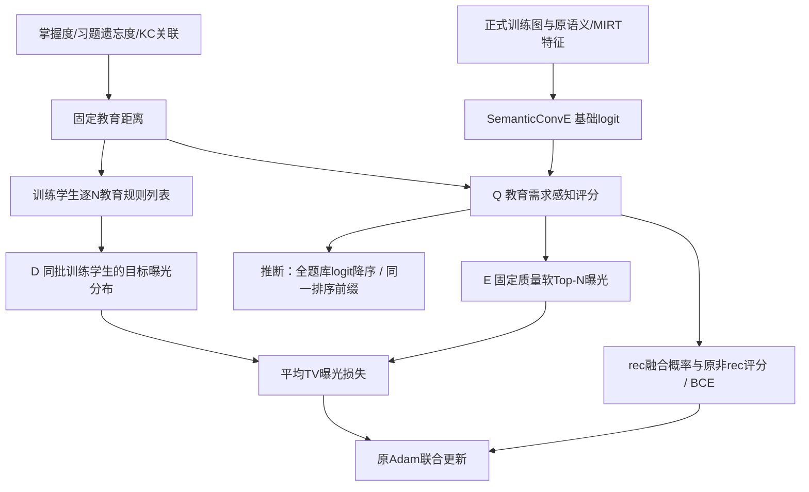

# 02 MAED-v1整体架构与模块说明

规范日期：2026-10-24。本文件为实现规范，不是论文方法章节初稿。

## 1. 正式结构与术语

\[
\mathrm{MAED\!\text{-}v1}=\mathrm{SemanticConvE}+Q+(D+E).
\]

Q和D+E是两部分核心技术设计。D、E是功能模块，不是两个额外神经网络。下文用二值矩阵A表示题目—知识点关联，避免与模块Q混淆。统一术语见根目录`CONTEXT.md`。

## 2. 数据流

图中的训练学生为独立均匀抽取的辅助学生集合，不是把测试学生接入训练，也不一定等于当前监督三元组的头实体集合。

## 3. 模块接口

|模块|输入|输出|是否新增可训练参数|主要代码|
|---|---|---|---|---|
|E0基础模型|实体/关系特征及三元组|原始logit|继承原模型参数|`codes-New-ConvE/semantic_conve_model.py`|
|Q|rec logit、学生与习题教育距离、训练尺度、beta|融合rec logit|否|`maed/scoring.py`、`maed/training.py::QScorer`|
|D|辅助训练学生、教育距离、各N|逐N目标习题曝光概率|否|`maed/exposure.py::rule_targets`|
|E|同批学生全题库融合logit、冻结温度、D目标|可微曝光、逐N TV及平均损失|否；梯度更新原模型|`maed/boundary_exposure.py`|
|联合训练|原BCE及曝光损失|原模型更新后的参数|原Adam一次更新|`maed/training.py::joint_loss/train`|
|评价与审计|保存的排序分数、固定评价上下文|教育/曝光指标和审计|否|`debias/metrics.py`、`mastery_ep_v2/evaluate.py`、审计脚本|

## 4. E0继承范围

正式基础模型是`SemanticConvE_feature_only`，不是V5/V6中的CompGCN或KPPD模型。

- 学生直接表征使用原MIRT能力特征；本版本未重写为可训练KC掌握向量编码器。
- 习题使用原共享文本编码及MIRT特征，KC保留原表示；关系使用原关系文本与强度表示。
- ConvE查询向量与尾实体做内积，再加原尾实体偏置得到logit。
- 保留原教育图关系、rec50标签、混合关系BCE和过滤负采样。

Q将更细的掌握/遗忘状态以固定适配项加入rec评分，不能据此写成已实现新的认知GNN或去相关用户编码器。

## 5. 训练与推断接口

- 监督训练：只在rec logit上加Q后sigmoid；非rec的logit不被Q直接修改。
- 辅助曝光训练：冻结BN统计并关闭Dropout行为，但保留autograd；为eval-GRU反向使用原生CUDA实现。切换异常时恢复各子模块模式。
- 推断：正beta时导出融合logit作为排序分数，避免sigmoid饱和并列；全题库排序不添加新的历史题过滤。
- 不在推断阶段执行D目标、曝光优化器或Post重排；D/E通过训练改变原模型参数。
- 相同分数按题目编号升序打破并列，各N从同一排序取前缀。

## 6. 方法组与模块关系

|组别|基础模型|Q评分|Q纳入监督训练|D/E曝光训练|
|---|---|---|---|---|
|E0|原ConvE|无|无|无|
|Q-fixed|冻结的同轮E0|有|否|否|
|M3|原初始化ConvE|有|是|否|
|M4 / MAED-v1|原初始化ConvE|有|是|是|
|R|不用训练模型|直接教育距离排序|否|否|

本轮没有独立训练ConvE+E且去掉Q的组，不能宣称已完成所有组合的全因子消融。Q-fixed−E0、M3−Q-fixed、M4−M3分别提供不同层面的受控对照。
